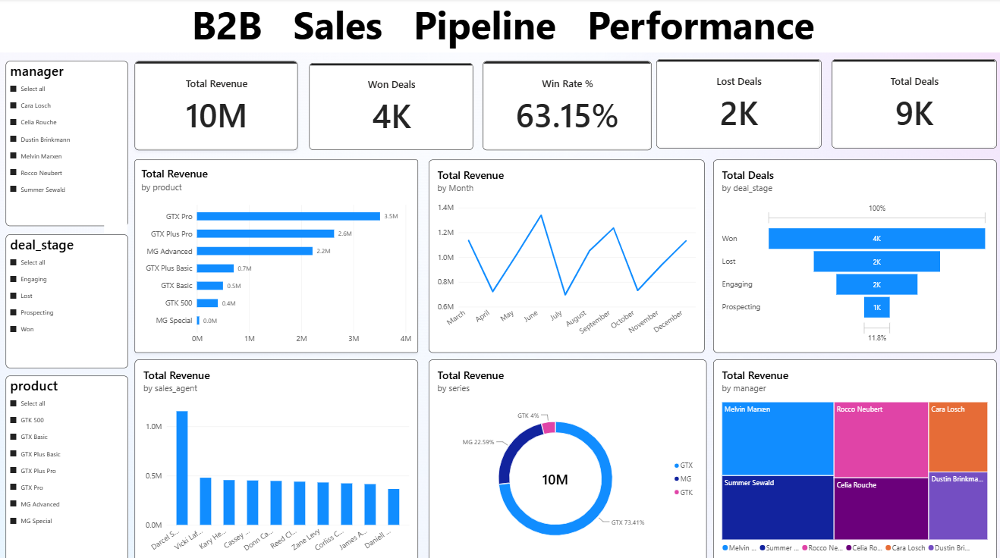

# B2B Sales Pipeline Performance Analysis

End-to-end analysis of a B2B sales pipeline (8,800 deals from a fictional computer hardware company), from raw data to an interactive Power BI dashboard.

## Business questions
- How are sales agents, managers and teams performing compared to each other?
- Which products bring in the most revenue?
- Are there quarter-over-quarter trends?
- How much revenue is still in the open pipeline?

## Tools
Python (pandas), MySQL, Excel, Power BI

## Workflow
1. **Cleaning (pandas):** checked missing values by deal stage, fixed a product name mismatch (`GTXPro` to `GTX Pro`), converted dates, and added sales cycle days and close year, quarter and month.
2. **Analysis (MySQL):** wrote SQL queries for headline KPIs, agent, product, quarterly and team performance, and the open pipeline.
3. **Validation (Excel):** rebuilt total deals and revenue in a pivot table and matched the SQL results.
4. **Dashboard (Power BI):** built a data model, DAX measures, 6 KPI cards, 6 charts and 3 slicers.

## Key results
- 8,800 deals, a 63.15% win rate, 10,005,534 in revenue, a 2,360.91 average deal size and a 51.8-day average sales cycle.
- 2,089 deals are still open, worth about 5M at list price.

## Insights
1. **Win rate is steady across teams** (62.1% to 64.4%), so revenue differences come from deal size and volume.
2. **Revenue depends heavily on one agent.** Darcel Schlecht brought in 1,153,214, about 11.5% of all revenue.
3. **Three products drive about 84% of revenue:** GTX Pro, GTX Plus Pro and MG Advanced. MG Special wins many deals but earns little (about 55 per deal).
4. **Revenue fell about 9% from Q2 to Q4**, with fewer won deals and smaller deals. Q1 is excluded because it only contains March.

## Project structure
- `Data/`: original CSV files
- `01_cleaning.ipynb`: data cleaning
- `cleaned/`: cleaned CSV files
- `sql/kpi_queries.sql`: analysis queries
- `excel/sales_validation.xlsx`: validation pivot tables
- `powerbi/sales_pipeline_dashboard.pbix`: dashboard
- `insights.md`: business insights

## Data
[CRM Sales Opportunities](https://mavenanalytics.io/data-playground/crm-sales-opportunities), Maven Analytics (public domain).